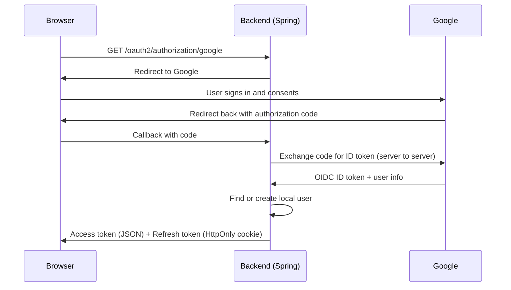

# Sports Club Management System

[](https://spring.io/projects/spring-boot)
[](https://www.oracle.com/java/technologies/javase/jdk21-archive-downloads.html)

A backend application for running a sports club: members, coaches, players, teams, matches, attendance, subscriptions and ticketing, all exposed through a REST API.

The project follows a layered architecture (Controller → Service → Repository) so each part stays easy to change and test. Authentication supports both classic credentials and **Sign in with Google (OAuth 2.0 + OpenID Connect)**, and every login ends with the same result: a JWT issued by this application.

---

## Table of Contents

- [Tech Stack](#tech-stack)
- [Architecture](#architecture)
- [Authentication & Security](#authentication--security)
- [Features](#features)
- [Design Decisions](#design-decisions)
- [Getting Started](#getting-started)
- [Testing](#testing)
- [Roadmap](#roadmap)

---

## Tech Stack

| Area | Technology |
|---|---|
| Language / Framework | Java 21, Spring Boot 3.4.3 |
| Database / ORM | MySQL 8, Spring Data JPA (Hibernate) |
| Security | Spring Security, JWT, OAuth 2.0 / OIDC (Google) |
| Migrations | Flyway |
| Mapping | MapStruct |
| Boilerplate | Lombok |
| API Docs | SpringDoc OpenAPI (Swagger UI) |
| Testing | JUnit 5, Mockito, Spring Boot Test |
| Deployment | Docker, Docker Compose, Docker Secrets |
| Config | java-dotenv (`.env` files) |

---

## Architecture

1. **Security layer:** authentication, token handling and role-based access (`Admin`, `Member`, `Coach`, ...).
2. **Controller layer:** REST endpoints, plus a `GlobalExceptionHandler` (`@ControllerAdvice`) that returns consistent JSON errors.
3. **Service layer:** business logic.
4. **Repository layer:** Spring Data JPA repositories.
5. **Entity layer:** the domain model (`User`, `Member`, `Coach`, `Team`, `Match`, `Ticket`, `Subscription`, `Attendance`, `UserIdentity`, ...).
6. **DTO & mapper layer:** MapStruct mappers keep the database schema separate from API payloads.
7. **Migrations:** versioned Flyway scripts that create tables, seed data and evolve the schema.

---

## Authentication & Security

### Overview

The API is stateless and secured with JWT. Google login was added on top of it without changing how the rest of the API is protected: Google is only used to **prove who the user is**. Once that's done, the backend issues **its own** tokens, and those are what protect every endpoint.

### Two security filter chains

OAuth login needs a short-lived session for the redirect handshake, while the API must stay fully stateless. Mixing both in one configuration causes conflicts, so they are split into two `SecurityFilterChain` beans:

| Order | Bean | Scope | Purpose |
|---|---|---|---|
| 1 | `oauthChain` | `/oauth2/**` and the login callback | Handles the Google authorization-code flow |
| 2 | `securityFilterChain` | Everything else | Stateless API, JWT validation (`ValidationFilter`), role checks |

### Login flow



Step by step:

1. The user opens `/oauth2/authorization/google` and is redirected to Google.
2. After consent, Spring receives the callback and exchanges the code for an OIDC token.
3. `OAuth2SuccessHandler` reads the user's name and email from the `OidcUser`.
4. `AuthService` looks up the matching `UserIdentity`. If none exists, a local user and identity are created.
5. `JwtService` generates the application's own access and refresh tokens.
6. The access token is returned in the response body; the refresh token is set as a cookie.

### Why the backend issues its own JWT

A Google token only tells us that Google authenticated someone. It is not meant to authorize requests to this API, and its claims and signing keys aren't ours to control. So the backend treats Google as an identity source, then signs a JWT with its own secret, containing the roles and claims this application needs. Authentication comes from Google; authorization stays in the application.

### Dual-token strategy

| Token | Lifetime | Where it lives | Notes |
|---|---|---|---|
| Access token | Short | Returned as JSON, kept in JavaScript memory by the client | Sent as `Authorization: Bearer ...` |
| Refresh token | Long | `HttpOnly`, `Secure`, `SameSite=Lax` cookie | Not readable from JavaScript |

Tokens are deliberately **not** stored in `localStorage`, since any XSS bug would expose them.

- `HttpOnly` stops scripts from reading the refresh token.
- `Secure` restricts the cookie to HTTPS.
- `SameSite=Lax` blocks the cookie on cross-site requests, which limits CSRF.

### Linking Google accounts to local users

Emails can change, so a Google account is not identified by email alone. A separate `user_identities` table links an external identity to a local user:

- `@OneToOne` + `@MapsId` shares the primary key with `User`, keeping a strict 1-to-1 relationship.
- The provider is stored with `@Enumerated(EnumType.STRING)` (`"GOOGLE"`), so reordering the enum never corrupts existing rows.
- The table is created through a Flyway migration like the rest of the schema.

This keeps the core user profile independent from login providers, so adding another provider later means adding rows rather than reshaping the schema.

## Features

- **Authentication & authorization:** credentials login, Google sign-in, JWT, role-based access.
- **User management:** members, players, coaches and admins.
- **Teams & matches:** organize players into teams and schedule matches.
- **Attendance tracking:** record attendance per session.
- **Subscriptions & ticketing:** subscription plans for members, match tickets with QR code support in the schema.

---

## Design Decisions

- **Layered structure:** controllers, services and repositories stay separate, so changes in one layer rarely leak into another.
- **Stateless API:** JWT validation needs no server-side session, and the OAuth handshake is isolated in its own filter chain.
- **Flyway:** the schema is versioned, so every environment ends up with the same database structure.
- **DTOs + MapStruct:** entities are never exposed directly, and mapping is checked at compile time.
- **Centralized error handling:** `GlobalExceptionHandler` turns exceptions into standard JSON responses with proper status codes.
- **Docker Secrets:** database passwords and JWT keys are provided as secrets instead of plaintext environment variables or image layers.

---

## Getting Started

### Prerequisites

- [Docker](https://www.docker.com/) and [Docker Compose](https://docs.docker.com/compose/)
- JDK 21 and Maven (only for running without Docker)
- A Google OAuth client (see below) if you want Google login

### Google OAuth setup

1. In the [Google Cloud Console](https://console.cloud.google.com/), create an OAuth 2.0 Client ID (type: Web application).
2. Add the authorized redirect URI:
   ```
   http://localhost:8080/login/oauth2/code/google
   ```
   (use port `8090` if you run through Docker and adjust accordingly).
3. Put the client ID and secret in your configuration (see below).

### Run with Docker Compose (recommended)

1. **Secrets:** create a `secrets/` directory at the project root with:
   - `db_password.txt`
   - `db_root_password.txt`
   - `jwt_secret.txt`
2. **Environment:** copy the template and fill it in:
   ```bash
   cp .env.example .env
   ```
   Typical variables: `DB_USERNAME`, `JWT_ACCESS_EXPIRATION`, `JWT_REFRESH_EXPIRATION`, `GOOGLE_CLIENT_ID`, `GOOGLE_CLIENT_SECRET`.
3. **Start:**
   ```bash
   docker-compose up
   ```
   This pulls MySQL, builds the app image, runs the Flyway migrations and starts everything.
4. **Stop:**
   ```bash
   docker-compose down
   ```

### Run locally

1. Start only the database: `docker-compose up -d mysql`
2. Make sure the environment variables from `.env` are available to Spring.
3. Run:
   ```bash
   ./mvnw spring-boot:run
   ```

### Try Google login

Open this in a browser:

```
http://localhost:8080/oauth2/authorization/google
```

After signing in you'll receive an access token in the response body, and the refresh token will be set as an `HttpOnly` cookie.

---

## Testing

```bash
./mvnw test
```

For manual testing, open Swagger UI at `http://localhost:8090/swagger-ui.html` (or `8080` when running locally). Log in first, copy the access token, and use the **Authorize** button to call secured endpoints.

---
